# House Price Prediction

## 1. The Question

This project began with a practical question: can a small linear model learn enough from a house's measurable characteristics to predict its price?

That question had a second part. Before training anything, I wanted to understand what I could see in the data myself. In particular:

- Would the relationship between square footage and price be as strong as it appeared visually?
- Could the other features improve predictions even when their individual relationships with price looked weak?
- Would gradient descent actually reduce the error and converge toward useful parameters?
- What would happen when I added L2 regularization and changed its strength?

The project was deliberately hands-on. Instead of calling a built-in machine-learning estimator, I implemented the important parts of linear regression myself: prediction, mean squared error, gradients, gradient descent, evaluation, and L2 regularization.

## 2. Getting to Know the Data

The dataset came from Kaggle and contains 1,000 house records with eight columns. Seven columns describe each house; `House_Price` is the target the model is asked to predict.

| Role | Feature | Type |
| --- | --- | --- |
| Input | `Square_Footage` | integer |
| Input | `Num_Bedrooms` | integer |
| Input | `Num_Bathrooms` | integer |
| Input | `Year_Built` | integer |
| Input | `Lot_Size` | float |
| Input | `Garage_Size` | integer |
| Input | `Neighborhood_Quality` | integer |
| Target | `House_Price` | float |

The first inspection checked the shape, column names, data types, missing values, duplicate rows, and summary statistics. The dataset had shape `(1000, 8)`. Every column had zero missing values, and there were zero duplicate rows, so I did not need imputation or duplicate removal for this experiment.

The target had a mean of approximately 618,861, a standard deviation of approximately 253,568, and ranged from approximately 111,627 to 1,108,237. The mean square footage was approximately 2,815, with a minimum of 503 and a maximum of 4,999.

The inspection was numerical, but numbers alone do not show the shape of a distribution. I therefore plotted the distributions of the numerical columns as the next step.

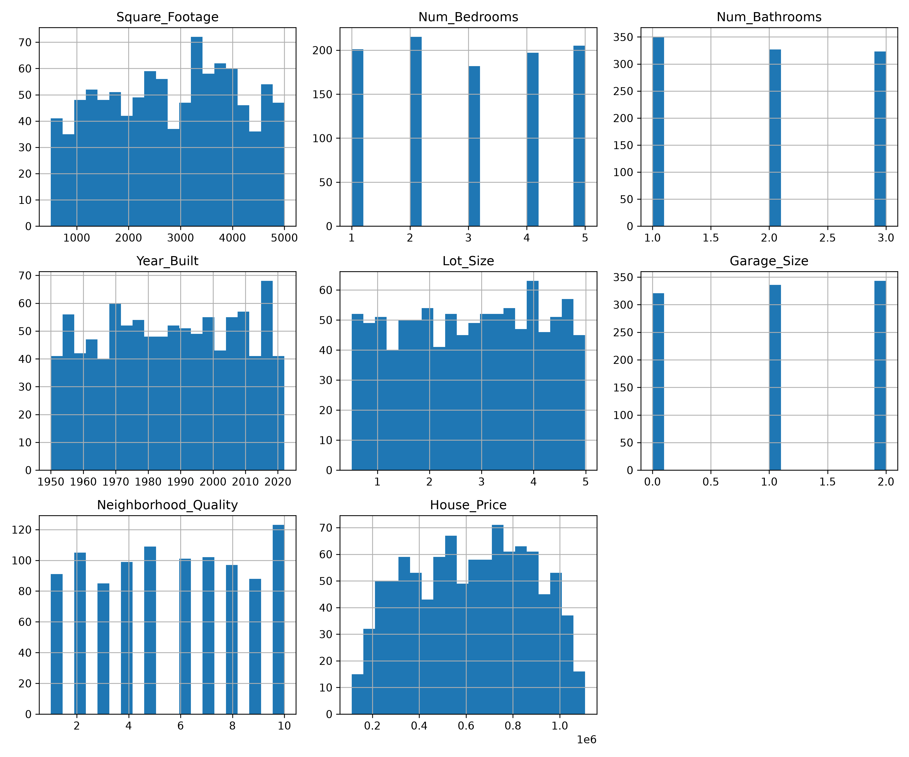

## 3. What Can We See?

The first visual question was whether each individual feature appeared to have a useful relationship with house price. The relationship plots are marginal views: each one compares one feature with price while leaving the other features aside.

Square footage stood out immediately. It showed a strong positive linear pattern: larger houses tended to have higher prices. The other features did not show an equally obvious individual linear relationship. That did not prove that they were useless; it only meant that their contribution was difficult to see one feature at a time.

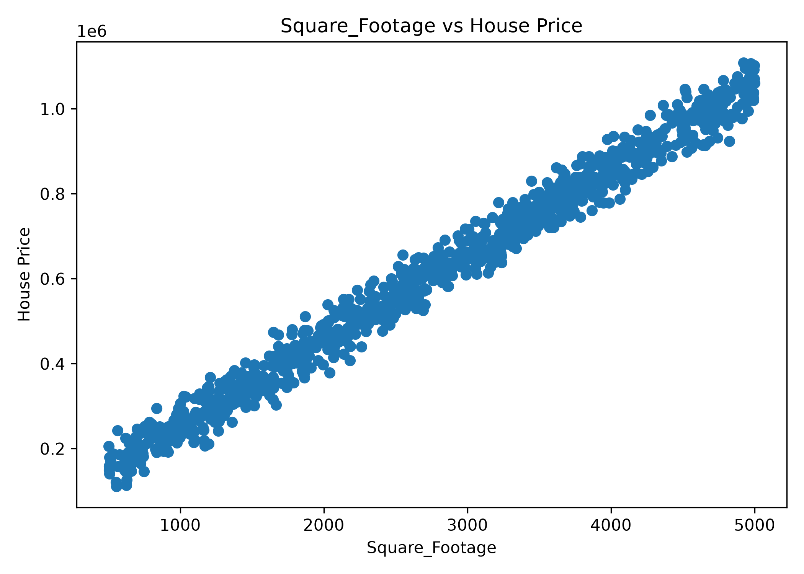

The correlation calculation made the contrast more precise. The correlations with `House_Price` were:

| Variable | Correlation with `House_Price` |
| --- | ---: |
| `Square_Footage` | 0.991261 |
| `Lot_Size` | 0.160412 |
| `Garage_Size` | 0.052133 |
| `Year_Built` | 0.051967 |
| `Num_Bedrooms` | 0.014633 |
| `Num_Bathrooms` | -0.001862 |
| `Neighborhood_Quality` | -0.007770 |
| `House_Price` | 1.000000 |

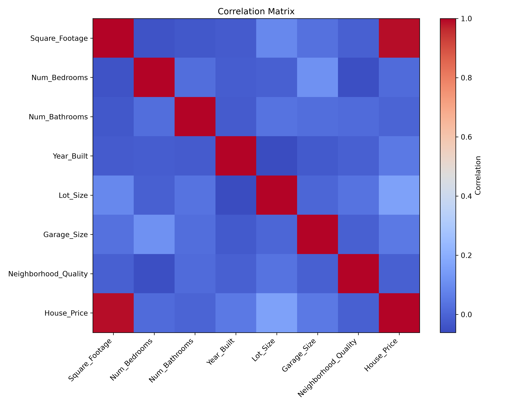

The remaining scatter plots show why the first model focused on `Square_Footage`, while also leaving open the possibility that the other variables might contribute information in combination.

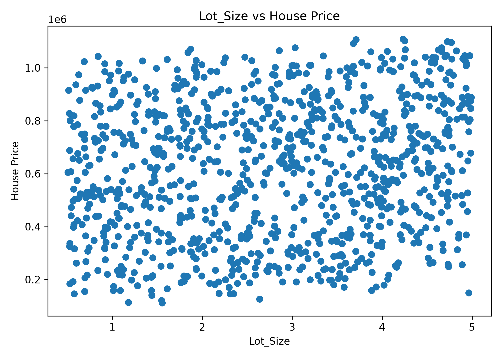

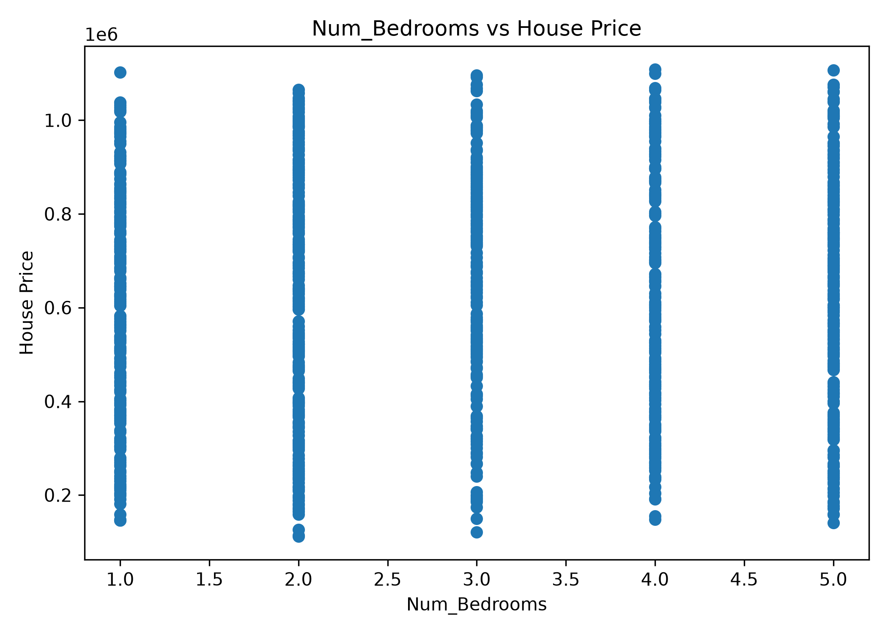

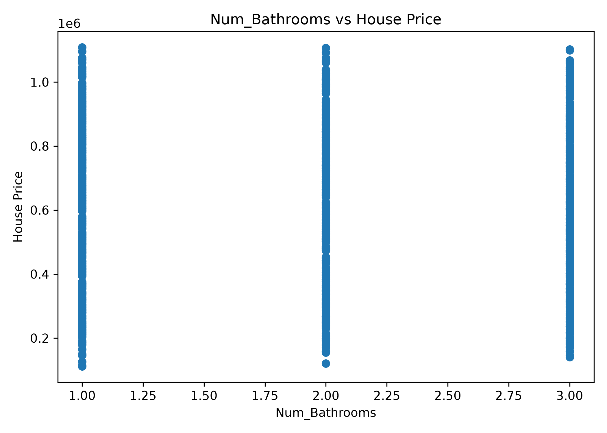

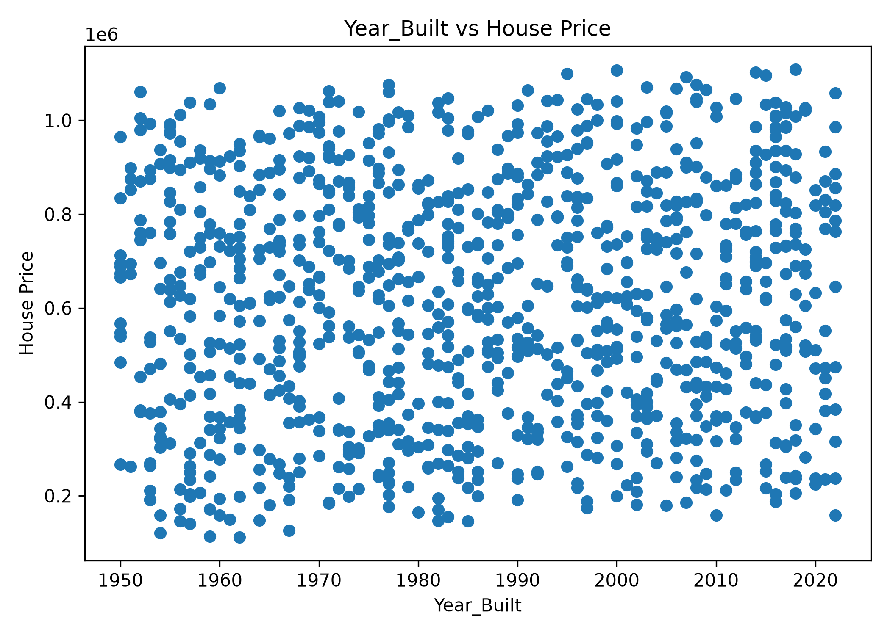

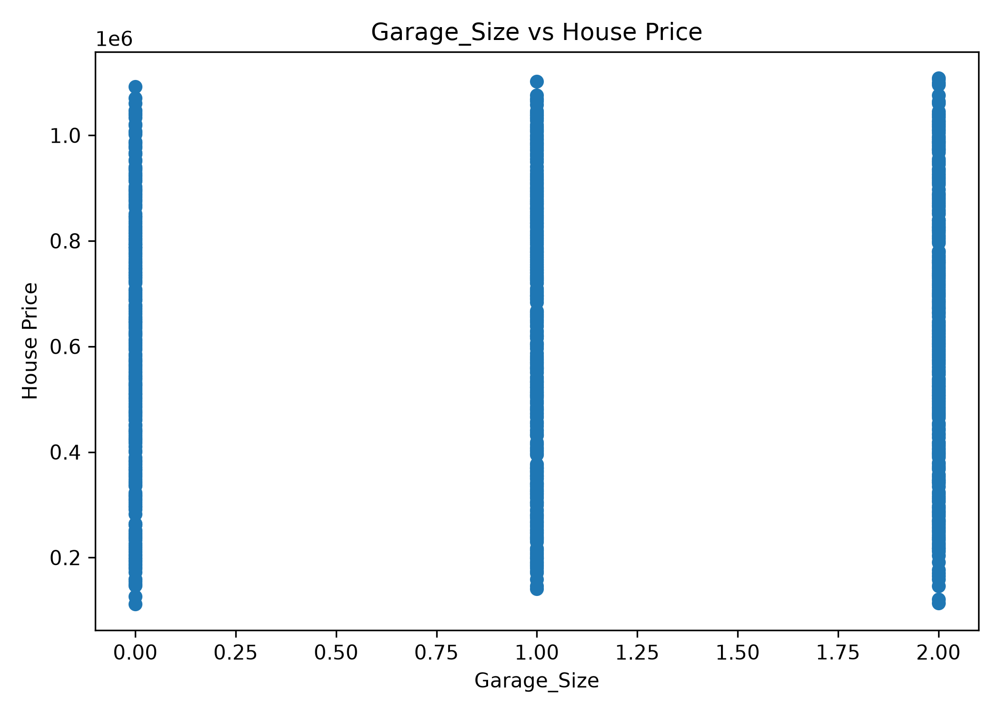

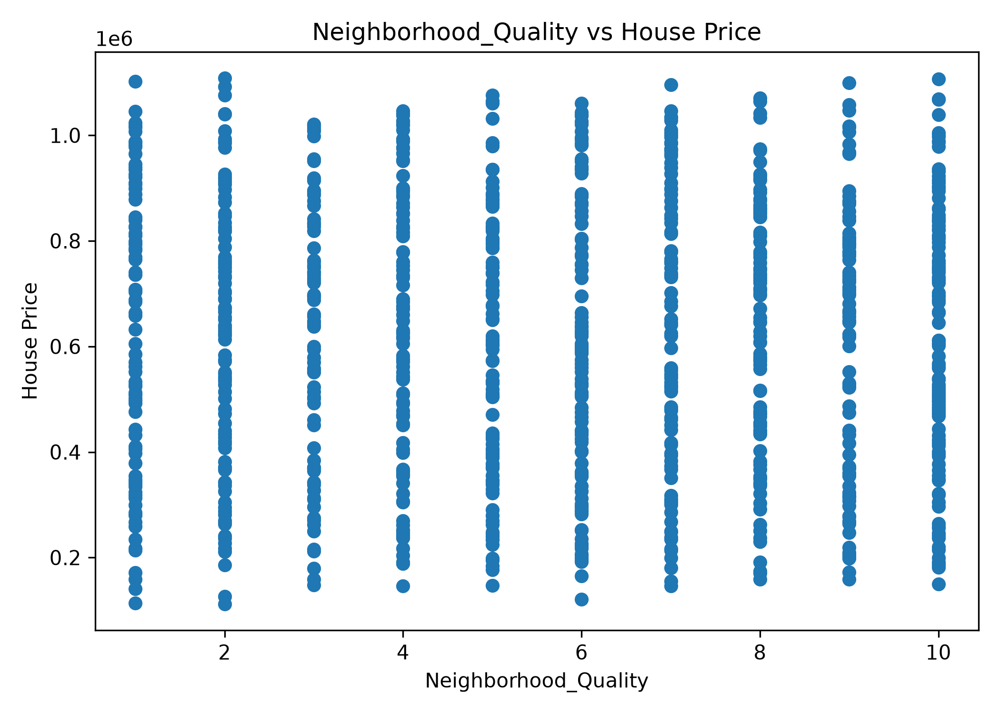

These plots shaped the experiment. A straight-line model seemed reasonable for the especially clear square-footage relationship, but the full model would test whether several weak marginal relationships could still be useful together.

## 4. Building the First Model

I started with one feature: `Square_Footage`. This was not because the other columns had already been ruled out. It was a way to make the learning process visible before introducing seven weights at once.

The first model was the line

$$
\hat{y} = wx + b
$$

where $w$ is the weight, or slope, and $b$ is the bias, or intercept. At the beginning, both were set to zero, so every initial prediction was zero. The data was shuffled with `random_state=42` and split into 800 training examples and 200 test examples.

The prediction code in the project is deliberately direct:

```python
w = 0
b = 0

predictions = w * X_train_feature + b
```

The model's predictions had to be compared with the real prices. I used mean squared error (MSE):

$$
\mathrm{MSE} = \frac{1}{n}\sum_{i=1}^{n}(\hat{y}_i-y_i)^2
$$

Squaring removes the sign of each error and gives larger errors more influence. With the initial all-zero predictions, the MSE was `444390967226.5864`. That large value was useful as a starting point: it gave gradient descent something to reduce.

## 5. What Did the Model Learn?

The model learned by repeating a simple cycle:

1. Make predictions with the current $w$ and $b$.
2. Calculate the errors and MSE.
3. Calculate the gradients.
4. Update $w$ and $b$ using a learning rate.
5. Repeat.

For the single-feature model, the gradients were implemented as:

```python
dw = (2 / n) * (X_train_feature * errors).sum()
db = (2 / n) * errors.sum()

w = w - learning_rate * dw
b = b - learning_rate * db
```

The learning rate was `0.00000001`, and the model was trained for 10,000 iterations. The loss fell quickly at the beginning and then changed more slowly. It went from approximately $4.44 \times 10^{11}$ at the start to approximately $1.62 \times 10^9$ after 10,000 iterations. The later, smaller changes were the observed sign that the updates were approaching convergence.

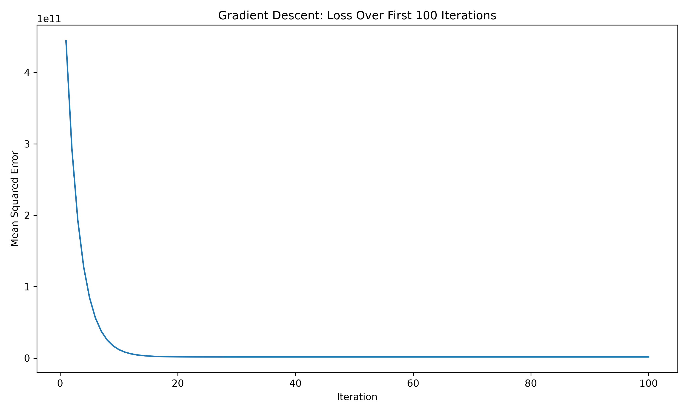

The learned single-feature model was evaluated with parameters trained only on the training set. The recorded results were:

| Evaluation set | MSE | RMSE |
| --- | ---: | ---: |
| Training | approximately 1.62 billion | not recorded in the notes |
| Test | approximately 1.63 billion | approximately 40,425 |

RMSE is the square root of MSE, so it returns to the same units as `House_Price`. Here, an RMSE of about 40,425 means the model's error was around 40,425 price-units in RMSE terms.

## 6. Adding Everything Together

The first model made the square-footage relationship concrete. The next experiment passed all seven input features to the same kind of linear model:

$$
\hat{y} = w_1x_1 + w_2x_2 + \cdots + w_7x_7 + b
$$

The implementation still used explicit matrix-style operations rather than a prebuilt regression estimator:

```python
predictions = X_train.dot(w) + b
errors = predictions - y_train
mse = (errors ** 2).mean()

dw = (2 / n) * X_train.T.dot(errors)
db = (2 / n) * errors.sum()

w = w - learning_rate * dw
b = b - learning_rate * db
```

The final reported multivariate parameters were:

| Feature | Learned weight |
| --- | ---: |
| `Square_Footage` | 199.707798 |
| `Num_Bedrooms` | 20.738960 |
| `Num_Bathrooms` | 5.703178 |
| `Year_Built` | 28.348949 |
| `Lot_Size` | 22.455047 |
| `Garage_Size` | 4.197419 |
| `Neighborhood_Quality` | 0.005873 |
| Bias | -0.177335 |

The recorded final test result was:

| Model | Test MSE | Test RMSE |
| --- | ---: | ---: |
| `Square_Footage` only | approximately 1.63 billion | approximately 40,425 |
| All seven features | 1,098,716,550.25 | 33,146.89 |

The decrease from roughly 40,425 to roughly 33,147 was the central result of the project. The features that looked weak individually still provided useful predictive information when the model considered them together. This does not show that those features cause prices to change; it shows that their learned combination improved prediction on the held-out data.

One caution matters when reading the weights. A larger weight does not automatically mean a feature is more important, because the features are measured on very different scales.

## 7. Can We Trust the Model?

The data was shuffled and split into 80% training data and 20% test data. The training data was used to update the parameters; the test data was held back until evaluation. This matters because evaluating on the same examples used for learning would not show whether the model had learned a relationship that transfers beyond those examples.

For the one-feature model, the training MSE was approximately $1.62 \times 10^9$ and the test MSE was approximately $1.63 \times 10^9$. Their closeness suggested that the model's error on unseen examples was similar to its error on the examples used for training.

The all-feature model also produced a lower test RMSE, approximately 33,147, in the recorded final run. That is evidence of useful generalization on this test split, not a claim that the model will perform identically on every new housing dataset. The evaluation answers the project's narrower question: with this dataset and this split, the learned relationships transferred well enough to reduce test error.

## 8. What Happens When We Regularize?

After the unregularized multivariate model, I tested L2 regularization. The purpose was to discourage very large weights by adding a penalty to the training loss:

$$
J_{reg} = \mathrm{MSE} + \lambda\sum_j w_j^2
$$

The gradient for each weight gained the corresponding regularization term, while the bias was left unregularized:

$$
dw = \frac{2}{n}X^T(\hat{y}-y) + 2\lambda w
$$

```python
regularization = lambda_reg * (w ** 2).sum()
loss = mse + regularization

dw = (2 / n) * X_train.T.dot(errors) + 2 * lambda_reg * w
db = (2 / n) * errors.sum()  # the bias is not regularized
```

I tested two very different strengths. With $\lambda=1$, the weights barely changed and the test performance was almost identical to the unregularized model. At that strength, the penalty was too small to visibly influence the fit.

With $\lambda=100000$, the weights were pushed substantially toward zero. For example, the notes record these changes:

| Feature | Before | After |
| --- | ---: | ---: |
| `Square_Footage` | 199.708298 | 191.036340 |
| `Num_Bedrooms` | 4.179434 | 0.260566 |
| `Num_Bathrooms` | 1.159661 | 0.092130 |
| `Lot_Size` | 4.535307 | 0.289710 |
| `Garage_Size` | 0.853554 | 0.064335 |

The stronger penalty changed the model, but the change was not an improvement in prediction. In the paired comparison run:

| Model | Test MSE | Test RMSE |
| --- | ---: | ---: |
| Unregularized | 1,100,359,070.23 | 33,171.66 |
| Regularized, $\lambda=100000$ | 1,259,815,289.11 | 35,493.88 |

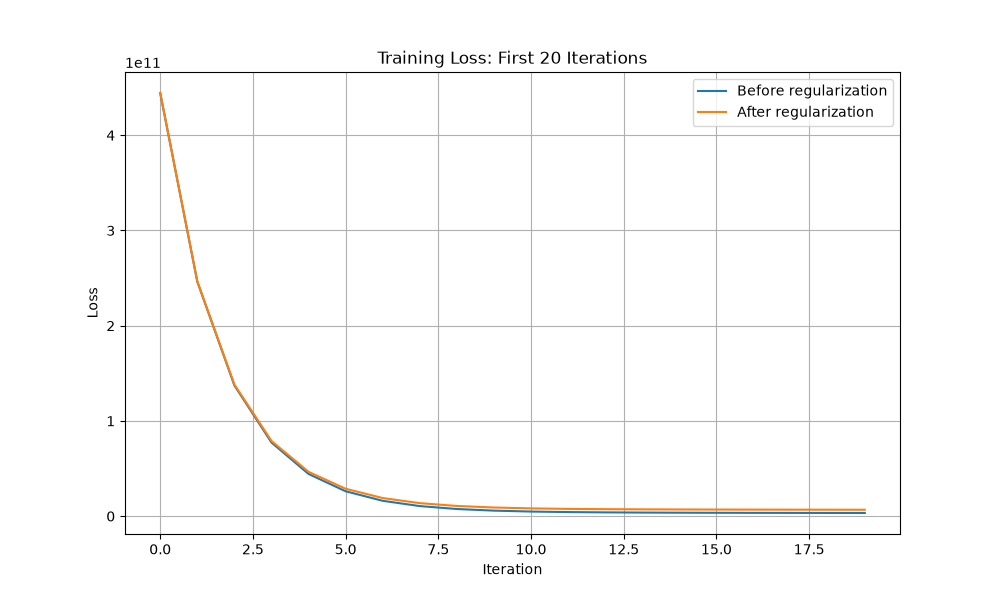

The actual-versus-predicted plot makes the same evaluation more concrete. The dashed diagonal is the perfect-prediction line; points closer to it represent predictions closer to the observed prices.

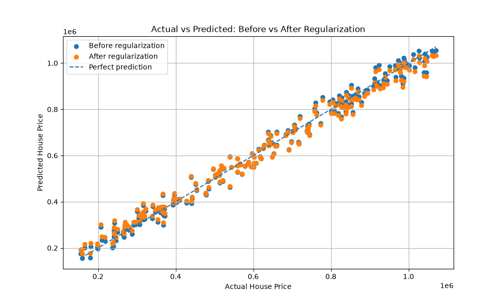

The experiment showed three distinct behaviors: a small $\lambda$ had little visible effect, a strong $\lambda$ reduced the weights, and an excessively strong penalty made the model too constrained and increased test error.

## 9. What I Learned

The strongest individual pattern was also the one the model learned most clearly. `Square_Footage` had a correlation of approximately 0.99 with `House_Price`, and the multivariate model assigned it a large weight of approximately 199.7.

The more interesting result was that the visual and correlation analysis did not tell the whole story. Several features looked weak when inspected separately, yet adding all seven features reduced test RMSE from about 40,425 to about 33,147. Their value appeared in the combination, not in an obvious one-variable scatter plot.

The training loop also made convergence observable rather than abstract. Starting from zero parameters, gradient descent reduced the loss quickly and then made smaller improvements. The model did not need a magic training command; its progress came from repeated predictions, errors, gradients, and updates.

Finally, regularization made the trade-off visible. Smaller weights are not automatically better. With $\lambda=100000$, the weights became smaller, but the test RMSE became worse. In this experiment, controlling the weights too aggressively removed information that helped the model predict the held-out prices.

## 10. Conclusion

This investigation followed one relationship from inspection to model learning. The dataset was already clean: 1,000 rows, seven input features, no missing values, and no duplicate rows. Exploration showed one dominant marginal relationship between square footage and price, while the other features appeared much weaker on their own.

The first hand-built linear regression model used only square footage. Its MSE fell from approximately $4.44 \times 10^{11}$ to approximately $1.62 \times 10^9$ during gradient descent, and its test RMSE was about 40,425. Adding the other six features reduced the recorded test RMSE to about 33,147.

That improvement answered the central question: the model learned useful information from combinations of features that were not individually obvious during exploration. The train/test comparison suggested that this improvement generalized to the held-out portion of this dataset.

The regularization experiment added a final qualification. L2 regularization can push weights toward zero, but its strength matters. $\lambda=1$ had almost no visible effect, while $\lambda=100000$ constrained the model enough to worsen the paired test RMSE from about 33,172 to about 35,494.

The result was not just a house-price estimate. It was a complete learning loop built and inspected directly: explore the data, choose the target and features, split the examples, predict, measure loss, calculate gradients, update parameters, evaluate unseen data, and test what changes when the objective is regularized.

